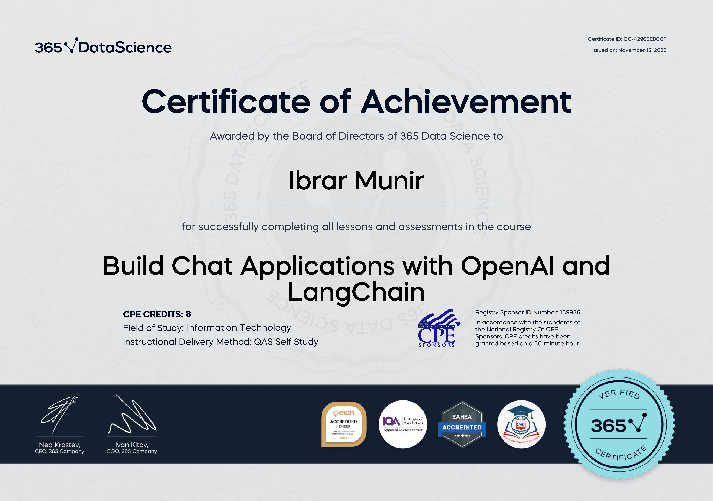

# Build Chat Applications with OpenAI and LangChain

## Overview

This repository contains my learning notes, exercises, and practical implementations from the **Build Chat Applications with OpenAI and LangChain** course.

The course focuses on building LLM-powered applications using OpenAI models and the LangChain Python framework. It covers prompt engineering, conversational memory, Retrieval-Augmented Generation (RAG), and agent tooling to develop context-aware chat applications.

## What I Learned

Throughout this course, I explored the following concepts and technologies:

- **LangChain Framework:** Understanding LangChain and integrating applications with Large Language Models (LLMs).
- **OpenAI Integration:** Connecting to OpenAI language models and embedding models through the API.
- **Prompt Engineering:** Creating effective prompts using chat prompt templates and few-shot prompting.
- **Conversation Memory:** Building conversational applications that retain context and remember previous interactions.
- **Output Parsers:** Structuring and processing LLM responses into usable formats.
- **Retrieval-Augmented Generation (RAG):** Connecting LLMs with external knowledge bases to answer questions about custom and previously unseen data.
- **LangChain Expression Language (LCEL):** Building composable chains and workflows for LLM-powered applications.
- **Environment Configuration:** Managing API keys and environment variables securely.

## Technologies & Tools

- Python
- OpenAI API
- OpenAI Language Models
- OpenAI Embedding Models
- LangChain
- LangChain Expression Language (LCEL)
- Retrieval-Augmented Generation (RAG)
- Prompt Templates
- Few-Shot Prompting
- Conversation Memory
- Output Parsers

## Key Learning Outcomes

By completing this course, I gained an understanding of how to:

- Integrate Large Language Models into Python applications using LangChain.
- Design prompts to guide and improve LLM responses.
- Build conversational chatbots with memory and contextual awareness.
- Retrieve relevant information from external knowledge sources using RAG.
- Create reusable and composable LLM workflows using LCEL.
- Understand how AI agents interact with external tools to accomplish tasks.

## Purpose

The purpose of this repository is to document my learning journey in Generative AI and LLM application development, strengthen my practical understanding of LangChain, and build a foundation for developing more advanced AI-powered applications.

## Certificate

Successfully completed the **Build Chat Applications with OpenAI and LangChain** course.

